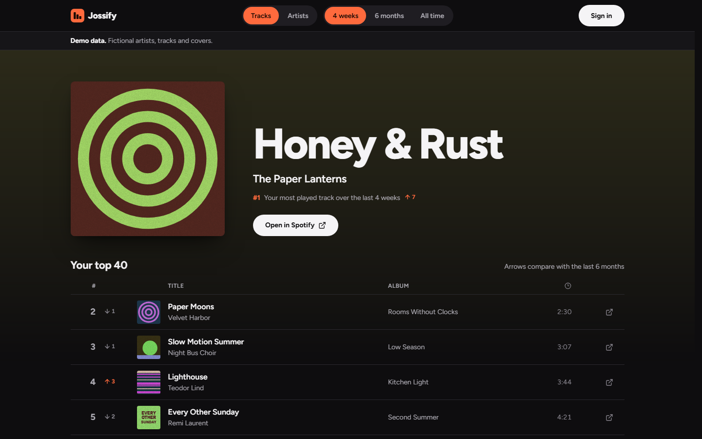
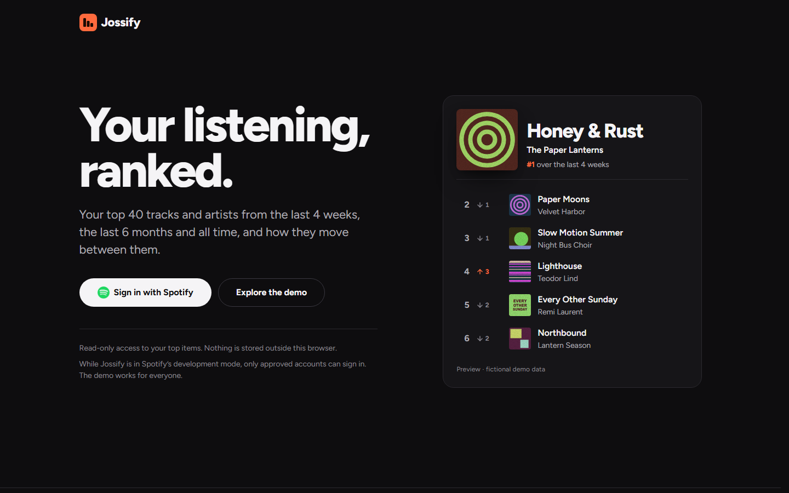
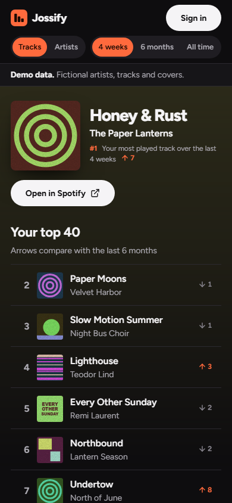
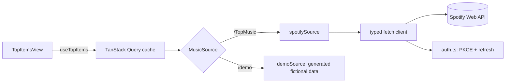

# Jossify

**Your Spotify listening, ranked.** Your top 40 tracks and artists from the last 4 weeks, the last 6 months and all time, and how they move between those ranges.

[](https://github.com/Josafath/Spotify-React-App/actions/workflows/ci.yml)

**Live:** https://jossify-joss.web.app · **Demo (no Spotify account needed):** https://jossify-joss.web.app/demo



<p>
  
  
</p>

<sub>Screenshots use the built-in demo data: every artist, track and cover in them is fictional.</sub>

## Features

- **Top tracks and top artists** for three time ranges, straight from the Spotify Web API.
- **Movement between ranges.** Each item shows whether it climbed, dropped, held or is new compared with the next longer range (4 weeks vs 6 months, 6 months vs all time).
- **Play any track or artist** in a docked player built on Spotify's official embed (iFrame API): full songs for listeners logged into Spotify in the browser, previews for everyone else. It falls back to a plain embed if the API can't load.
- **Shareable views.** The selected type and range live in the URL (`/demo?type=artists&range=long_term`).
- **Demo mode** with generated, clearly labelled fictional data, so anyone can try the app while it is in Spotify's development mode (where only approved accounts can sign in).
- **Secure, backend-free sign-in** with the OAuth 2.0 Authorization Code flow + PKCE, including token refresh.
- **Every state handled:** loading skeletons, empty ranges, expired sessions, rate limits and network errors, each with a way forward.
- **Accessible and responsive:** keyboard-operable controls built on native radios, visible focus, screen-reader labels for rankings and movement, `prefers-reduced-motion` respected, WCAG AA contrast, layouts tested from 320 px to desktop.

## Tech stack

| Area | Choice |
| --- | --- |
| UI | React 19, TypeScript (strict), CSS Modules with design tokens |
| Routing | React Router 7 |
| Data | TanStack Query 5 over a typed `fetch` client |
| Auth | Spotify Authorization Code + PKCE, fully client-side |
| Tooling | Vite 7, ESLint 9 (typescript-eslint, react-hooks) |
| Tests | Vitest 3, Testing Library, jsdom |
| CI | GitHub Actions: lint, type-check, tests and build on every push |
| Hosting | Firebase Hosting |

## Architecture

```
src/
├── app/                  App shell: routes and the QueryClient (retry policy)
├── lib/spotify/          Infrastructure, no React
│   ├── auth.ts           PKCE flow, token storage and refresh
│   ├── client.ts         Typed fetch client and SpotifyApiError
│   ├── types.ts          Spotify Web API types
│   └── images.ts         Image-size picking, duration formatting
├── features/
│   ├── auth/             Start page and its live preview
│   ├── top-items/        The ranking screen
│   │   ├── musicSource.ts    MusicSource interface + Spotify implementation
│   │   ├── queries.ts        TanStack Query hooks
│   │   ├── movement.ts       Rank comparison between ranges (pure)
│   │   ├── displayItem.ts    Track/Artist → one view model
│   │   └── components/       Hero, track list, artist grid, top bar…
│   └── demo/             Fictional data source + demo page
├── components/           Shared UI (segmented control, buttons, footer, states)
└── styles/               Design tokens and global styles
```



### Design decisions

- **One UI, swappable data source.** Screens only know the `MusicSource` interface, provided through React context. The Spotify and demo pages are the same component tree with a different source, which also makes the UI easy to test.
- **Pure logic, kept out of components.** Ranking movement (`movement.ts`), range metadata and the display model are plain functions with their own unit tests.
- **Errors carry meaning.** `SpotifyApiError` exposes `isAuthError` and `isRateLimited`. The UI turns them into specific recovery actions, and the query client skips retries on errors a retry cannot fix.
- **The auth code is exchanged exactly once.** Concurrent callers (for example React StrictMode effects) share one in-flight promise, the code is removed from the URL straight away, and `state` is checked to prevent CSRF.
- **Typed end to end.** Strict TypeScript with `noUncheckedIndexedAccess`; Spotify fields that are no longer guaranteed (such as `genres`) are optional in the types and handled in the UI.

## Getting started

Requires Node 20.19+ (or 22.12+).

```sh
npm install
npm run dev          # http://127.0.0.1:3000
```

Open http://127.0.0.1:3000/demo to explore without a Spotify account.

### Spotify setup

1. Create an app in the [Spotify Developer Dashboard](https://developer.spotify.com/dashboard).
2. Add these Redirect URIs exactly:
   - `http://127.0.0.1:3000/TopMusic` (Spotify does not accept `localhost`)
   - your production URL + `/TopMusic`
3. Optionally override the defaults in `.env.local`:

```sh
VITE_SPOTIFY_CLIENT_ID=your_client_id
VITE_SPOTIFY_REDIRECT_URI=http://127.0.0.1:3000/TopMusic
```

In development mode, Spotify only lets accounts added under *User Management* sign in.

## Scripts

| Command | What it does |
| --- | --- |
| `npm run dev` | Dev server on 127.0.0.1:3000 |
| `npm run build` | Type-check and build to `build/` |
| `npm run preview` | Serve the production build |
| `npm test` | Run the test suite once (`npm run test:watch` to watch) |
| `npm run lint` | ESLint |
| `npm run typecheck` | TypeScript, no emit |
| `npm run check` | Everything CI runs |

## Testing

Unit tests cover the PKCE flow (including the RFC 7636 challenge, CSRF state check, single code exchange and token refresh), the API client's error handling, ranking movement and image helpers. Integration tests render the real app with a memory router to cover sign-in, redirects, the signed-in screen against a mocked Spotify API, empty and expired-session states, and the demo's URL-driven views.

## From v1 to v2

Jossify started in June 2021. v2 is a rebuild that reflects how I work now:

| | v1 (2021) | v2 |
| --- | --- | --- |
| Language | JavaScript | TypeScript, strict |
| Tooling | Create React App 4 | Vite 7, ESLint 9, GitHub Actions CI |
| React | 17, router v5 | 19, React Router 7 |
| Auth | Implicit Grant (since retired by Spotify), token parsed by character offset | Authorization Code + PKCE with refresh and CSRF check |
| Data fetching | Six sequential axios calls in one `useEffect` | Typed `fetch` client, TanStack Query cache, parallel requests |
| Structure | Six near-identical components per range | Feature folders, one view model, a swappable data source |
| States | Crashed on empty data, no error handling | Loading, empty, error, expired session and rate limit states |
| Design | Mixed English/Spanish, DOM-manipulated popups | One design system with tokens, responsive and accessible |
| Tests | None (default CRA test, failing) | Unit + integration tests in CI |

## License and attribution

Music data and artwork come from Spotify through the Spotify Web API. Jossify is an independent project and is not affiliated with or endorsed by Spotify.
